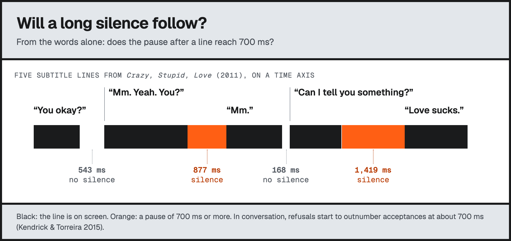
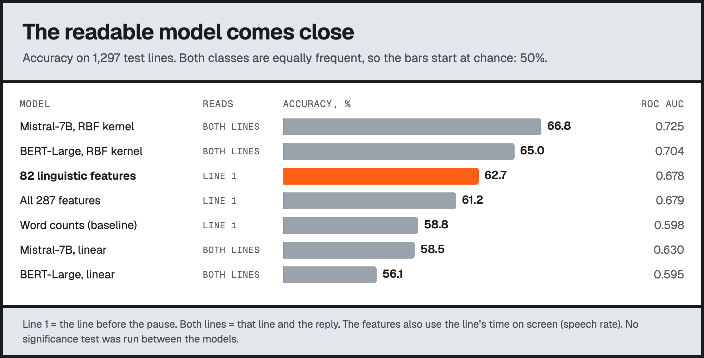
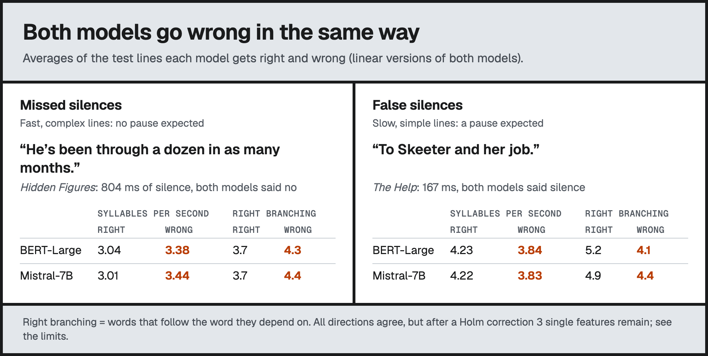

# Investigating Silence in Written Text and Large Language Models

When somebody stops talking, how long will it stay quiet? A dialogue system that only has the words has to guess.



My M.A. thesis (Speech and Language Processing, University of Konstanz, 2026) asks two things:

1. How much does the text of a line tell you about the pause after it?
2. Where BERT and Mistral-7B get it wrong, can linguistic features show what those lines have in common?

**[Open the notebook](thesis_notebook.ipynb)**: the whole study with its output. The thesis text itself is not part of this repository.

## Results

- **Text carries a real but limited signal.** The best model reaches 66.8% accuracy and a ROC AUC of 0.725; guessing gives 50% and 0.5.
- **82 readable features come within 4 points of it:** 62.7%, AUC 0.678, with 50 times fewer dimensions. They see only the line before the
  pause; the transformers see the reply too.
- **Speech rate is the strongest feature.** Lines before a long silence are slower: 3.3 against 4.1 syllables per second.
- **Syntax does most of the work.** The 172 syntactic features alone reach 62.1% (speech rate is one of them), the 68 affect
  features 57.9%.



All numbers: [results/](results).

*Words used here:* **accuracy** = share of lines labelled correctly · **ROC AUC** = how well a model ranks silences above non-silences ·
**SVM** = the classifier on top of features or embeddings; a **linear** one draws a straight border, an **RBF** one a curved border ·
**embedding** = the numbers a language model turns a text into.

## How it works

1. **Data.** Subtitles of 13 English-language films, mostly biopics and dramas. Blocks that split a sentence are joined, then the pause
   between two lines is measured. Two films with data problems are left out. 12,970 pairs from 11 films remain, half of them with a pause
   of 700 ms or more, the length at which refusals start to outnumber acceptances in conversation (Kendrick & Torreira 2015).
2. **Features.** 287 per line: syntactic (172), affect (68), lexical-semantic (27) and structural (20), from spaCy, LFTK and rules written
   for subtitles, such as sound descriptions (`[SIGHS]`), bare wh-questions and lines that break off.
3. **Selection.** LASSO keeps 82 of the 287.
4. **Models.** Linear SVMs on the features; linear and RBF SVMs on embeddings of BERT-Large (fine-tuned) and Mistral-7B (frozen); word counts
   as the baseline. Train / validation / test: 10,376 / 1,297 / 1,297 pairs.
5. **Error analysis.** The 82 features describe the lines the two transformer models get wrong.

## Where the transformers go wrong



Both models expect silence after slow, simple lines and no silence after fast, complex ones, and fail where a line breaks that pattern. A
system that has to decide when to speak would probably need the voice there.

The models also seem to differ: BERT's errors go together with discourse markers such as *but* and *however*, Mistral's with emotion. This
part is a hint only, because it does not survive a correction for multiple testing (next section).

## Limits

- **The models do not read the same thing.** The features use the line before the pause. BERT and
  Mistral read that line and the reply. The thesis baseline was trained on both lines and tested on one, which holds it back: 57.1%.
  Trained and tested on the first line it reaches 58.8%, on both lines 61.8%.
- **Speech rate is not only text.** It uses the time a line is on screen. Alone it reaches 60.0% (AUC 0.642); the other 81 features without it
  reach 62.5% (AUC 0.662).
- **The error analysis uses the linear models**, whose accuracy is 56.1% and 58.5%. It tests 82 features at a time without a correction in
  the thesis; about 4 of 82 fall below 0.05 by chance. After a Holm correction 3 of them hold, all structural: right branching and
  dependency distance in BERT's false silences, punctuation variety in Mistral's missed silences.
- **The split is by line, not by film.** The same films are in training and test, and 89% of the test pairs share a line with a training
  or validation pair.
- **Not all 287 features are informative.** 22 are the same on every line (20 of them are the counts of positive and
  negative words, which came out as 0 everywhere) and 9 repeat another one, which leaves 256.
- **Film is not conversation.** Subtitle times reflect editing as well as speech. I tested one threshold, searched no settings for the
  embedding models and ran no significance test between the models.

The matched baselines, the runs on speech rate, the Holm correction, the shared lines and the column count are not in the thesis; I added them
for this repository (notebook, sections 7 and 9). The chart above shows the matched baseline on the first line.

## Reproduce it

```bash
git clone https://github.com/Panoserms/Panagiotis_Ermeidis_Master_Thesis
cd Panagiotis_Ermeidis_Master_Thesis
python3.11 -m venv .venv && source .venv/bin/activate
pip install -r requirements.txt && python -m spacy download en_core_web_sm
python -m pytest            # quick check
jupyter notebook thesis_notebook.ipynb
```

The feature models, the feature groups and the error analysis run from this repository alone. The subtitles are copyrighted and the
embeddings are too large; [data/README.md](data/README.md) says where to put them.

| Path | What it is |
|---|---|
| `thesis_notebook.ipynb` | the whole study, with saved output |
| `silence/` | subtitles, features, models, error analysis |
| `gpu/` | BERT fine-tuning and the Mistral embeddings |
| `data/` | feature tables and predictions (numbers only, no film text) |
| `results/` | tables behind the numbers above |

## Licence

Code: [MIT](LICENSE). The film lines quoted here belong to their owners. Built with spaCy, LFTK, scikit-learn, NLTK (VADER), the GoEmotions model by Sam Lowe, the NRC Emotion Lexicon, BERT-Large and
Mistral-7B; subtitles from OpenSubtitles.
